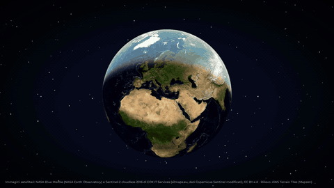
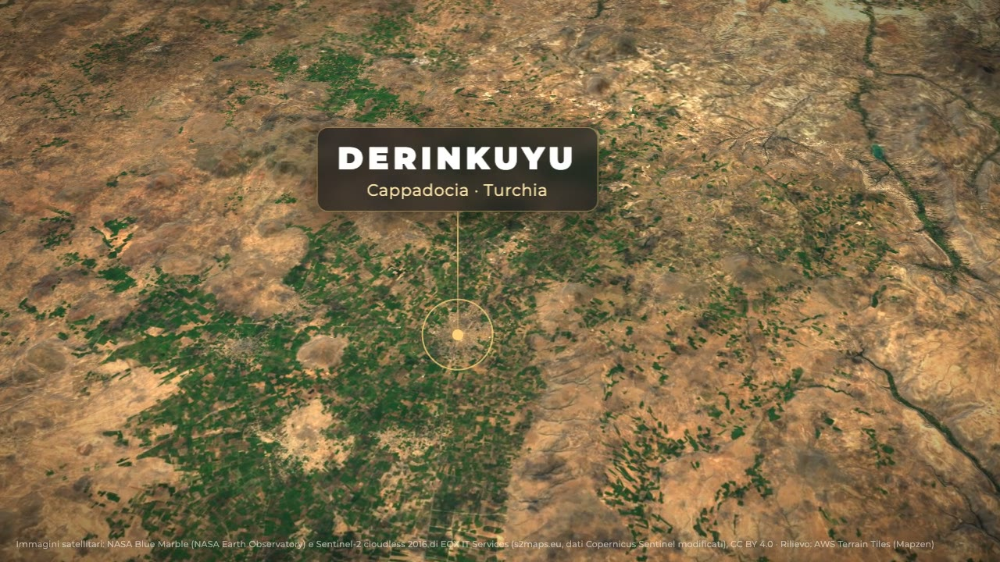
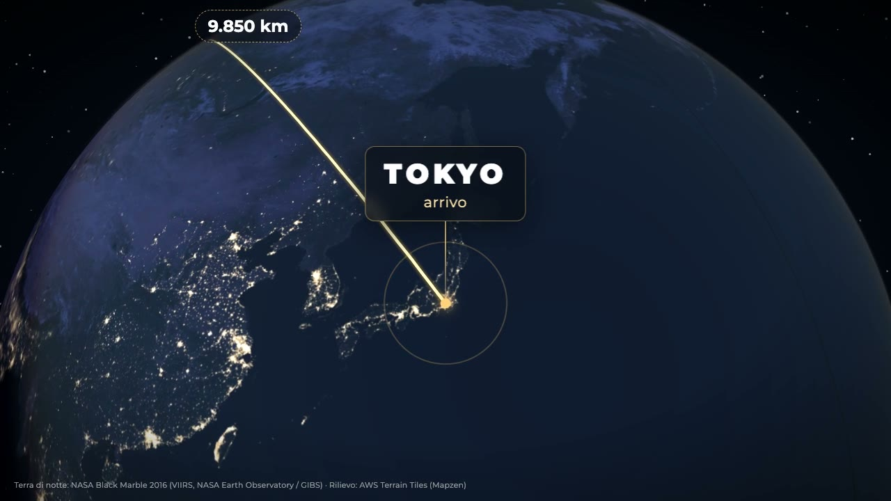
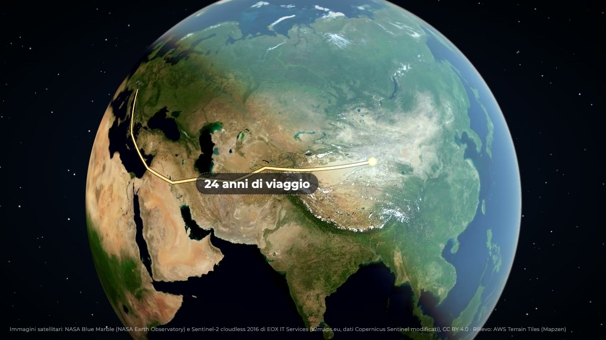
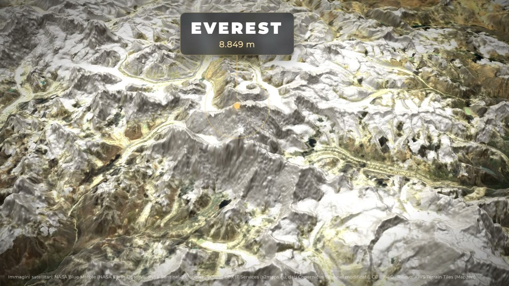

# 🌍 globo-premium

**Voli di camera su un globo 3D con immagini satellitari vere, per i tuoi video.** Dallo spazio al punto esatto,
percorsi animati, la Terra di notte con le luci delle città, montagne in 3D. Verticale 9:16 (Short, Reel, TikTok) o orizzontale 16:9.

Funziona da solo da riga di comando, oppure come **skill di Claude Code**: descrivi il viaggio a parole e Claude scrive il file e fa il render.



## Cosa sa fare
- 🛰️ **Volo dallo spazio al punto esatto**, con immagini satellitari vere (NASA Blue Marble da lontano, Sentinel-2 da vicino, senza riquadri)
- 🧭 **Percorsi animati** (pieni o tratteggiati) con una nota: anni, km…
- 🌃 **Terra di notte** con le luci delle città (NASA Black Marble)
- 🏔️ **Rilievo 3D** delle montagne (fino in cima all'Everest)
- 📍 **Pin con carta** ed etichette di regione
- 🎞️ Render **deterministico** fotogramma per fotogramma: nessun salto, nessuna tessera mancante
- 🏷️ Schede e note **sempre dentro il quadro**, anche nel verticale
- ⚡ **Bozza veloce** a metà risoluzione che inquadra esattamente come il definitivo
- 🆓 Tutte fonti **gratuite**, utilizzabili anche in video monetizzati con il credito (già scritto in basso a sinistra)

## Schermate
| | |
|---|---|
|  |  |
| **Dallo spazio al punto esatto**: Derinkuyu, Turchia | **Terra di notte** con rotta e distanza: Roma → Tokyo |
|  |  |
| **Percorsi animati**: il viaggio di Marco Polo | **Rilievo 3D**: fino in cima all'Everest |

## Installazione

### In Claude Code (consigliato): un comando
```
/plugin install globo-premium --marketplace danilopalomba/globo-premium
```
Poi chiedi a Claude, per esempio: *«Fammi un volo 9:16 da Roma a Tokyo di notte, 7 secondi, con la distanza in km»*.
Al primo uso Claude installa da solo quello che serve (`installa.sh`). Servono [Node.js](https://nodejs.org) 18+ e [ffmpeg](https://ffmpeg.org).

Con versioni di Claude Code più vecchie: `/plugin marketplace add danilopalomba/globo-premium` e poi `/plugin install globo-premium@danilopalomba`.

### Da riga di comando
```bash
git clone https://github.com/danilopalomba/globo-premium.git
cd globo-premium/skills/globo-premium
bash installa.sh         # una volta sola
npm run esempio          # bozza di prova: prova.mp4 + prova.jpg
```
**Le mappe sono già comprese:** nessuna chiave API, nessun account, niente da scaricare a mano. Il motore prende da solo le
immagini satellitari, la Terra di notte e il rilievo dai server pubblici gratuiti mentre fa il render (serve solo la connessione a internet).
Il mondo intero in alta risoluzione pesa terabyte, per questo non sta dentro il repository.

Vuoi la skill senza plugin? Copia la cartella `skills/globo-premium` in `~/.claude/skills/`.

## Uso da riga di comando
```bash
cd skills/globo-premium
node motore/render.mjs motore/esempi/marco_polo.json bozza.mp4 --scala 0.5 --fps 15 --foglio foglio.jpg   # bozza veloce
node motore/render.mjs motore/esempi/marco_polo.json marco_polo.mp4                                        # definitivo
```
Il formato del file del viaggio (camera, pin, percorsi, stile notte, rilievo) è spiegato in [SKILL.md](skills/globo-premium/SKILL.md).
Il video esce muto: voce e musica si aggiungono nel montaggio.

## Licenze
- **Codice:** MIT.
- **Mappe e dati:** il motore li prende dai server pubblici durante il render. Sentinel-2 cloudless 2016 di EOX (CC BY 4.0),
  NASA Blue Marble e Black Marble 2016, AWS Terrain Tiles (Mapzen). Dettagli e testo dei crediti in [CREDITI.md](CREDITI.md).
- **Font:** Montserrat, SIL Open Font License.

---

## English
**globo-premium** renders cinematic camera flights over a 3D globe with real satellite imagery: from space down to an exact spot,
animated routes, Earth at night, 3D mountains. Vertical 9:16 or horizontal 16:9, frame-by-frame deterministic MP4 (silent).

```bash
# Claude Code: /plugin install globo-premium --marketplace danilopalomba/globo-premium
cd skills/globo-premium && bash installa.sh   # once; map imagery needs no keys or downloads, it is streamed at render time
node motore/render.mjs motore/esempi/notte_roma_tokyo_169.json out.mp4 --scala 0.5 --fps 15   # draft
```
Use it standalone or as a Claude Code plugin (one command, see above).
The journey file format is documented in skills/globo-premium/SKILL.md (in Italian; the keys are short and the examples are self-explanatory).
Set `"crediti"` in the journey file to translate the on-screen credit line. Code: MIT. Imagery and data: see CREDITI.md
(EOX Sentinel-2 cloudless 2016 CC BY 4.0, NASA Blue Marble and Black Marble, AWS Terrain Tiles).

Made with Claude Code by [Danilo Palomba](https://www.youtube.com/channel/UCZqk-BwUpQUVX7RVmLQTcCA).
